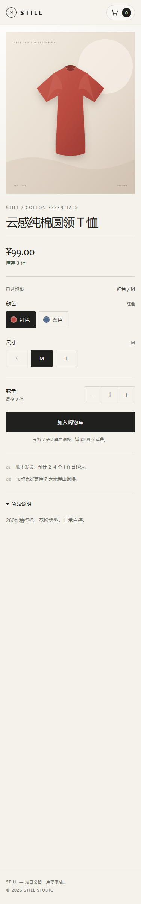
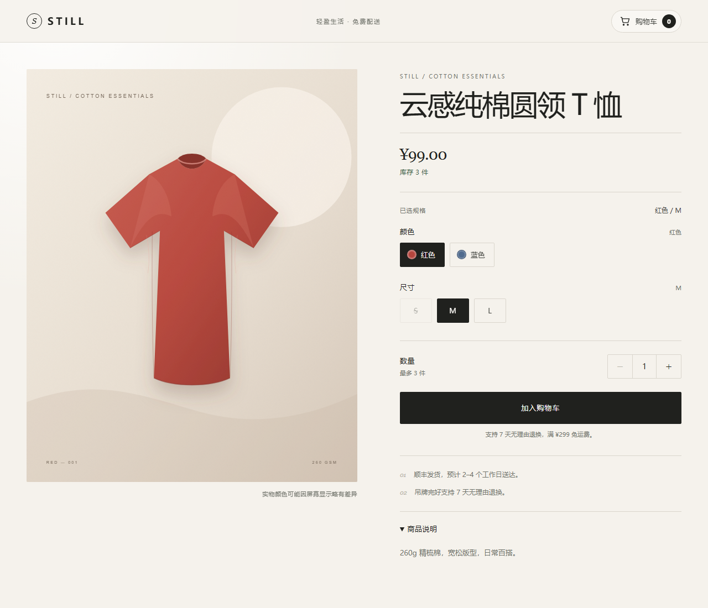

# Variant PDP

基于 **React 18 + TypeScript + Vite** 的商品详情页，已对接本机 FastAPI 后端（`http://127.0.0.1:8000`）。包含颜色 / 尺寸变体解析、缺货禁用、数量上限收敛、幂等加购、购物车总数同步、加载与错误重试，以及 Vitest + React Testing Library 测试。

## 快速开始

先安装 [Node.js LTS](https://nodejs.org/zh-cn/download)（自带 npm）。然后在 Windows 上直接双击项目根目录的 `start-pdp.bat`，脚本会检查 Node、按需安装依赖并启动 Vite，浏览器会自动打开。

在 PyCharm 的 Terminal 中进入本 README 所在的 `frontend` 目录后执行：

```bash
npm install
copy .env.example .env   # Windows；macOS / Linux 使用 cp .env.example .env
npm run dev
```

项目不提交本机 `.env`。`vite.config.ts` 在缺少 `.env` 时默认代理到 `http://127.0.0.1:8000`，所以直接 `npm run dev` 也能跑通；要指向别的地址时再从 `.env.example` 复制并按需修改。默认配置为：

```dotenv
VITE_API_PROXY_TARGET=http://127.0.0.1:8000
VITE_PRODUCT_ID=tee-001
```

开发服务器会把 `/api` 代理到 FastAPI；生产环境直接把前端与 API 部署在同源即可。

常用命令：

```bash
npm run typecheck   # tsc -b
npm test            # vitest run
npm run build       # tsc -b && vite build
```

## 后端接口契约

后端实际返回的数据会先在 `src/api.ts` 中规范化，再交给组件：

- `options[].key` → `options[].id`
- SKU 顶层的 `color` / `size` → `sku.options`
- `cart.total_items` → `cart.totalQuantity`

这样未来后端字段微调时，业务组件不需要跟着改。

### `GET /api/products/tee-001`

```json
{
  "id": "tee-001",
  "name": "云感纯棉圆领 T 恤",
  "description": "260g 精梳棉，宽松版型，日常百搭。",
  "currency": "CNY",
  "options": [
    {
      "key": "color",
      "name": "颜色",
      "values": [
        { "value": "red", "label": "红色" },
        { "value": "blue", "label": "蓝色" }
      ]
    },
    {
      "key": "size",
      "name": "尺寸",
      "values": [
        { "value": "S", "label": "S" },
        { "value": "M", "label": "M" },
        { "value": "L", "label": "L" }
      ]
    }
  ],
  "skus": [
    {
      "id": "SKU-RED-M",
      "color": "red",
      "color_label": "红色",
      "size": "M",
      "price": 99,
      "stock": 3,
      "available": true
    }
  ]
}
```

- 商品 ID 默认为 `tee-001`，可通过 `VITE_PRODUCT_ID` 覆盖。
- `price` 单位为元，`stock` 为非负整数，`stock === 0` 即缺货。
- 每个 SKU 都带 `image` 字段，前端直接使用；字段缺失时才按颜色回退到 `public/images/tee-red.svg` / `tee-blue.svg`。

### `GET /api/cart`

```json
{
  "items": [
    {
      "sku_id": "SKU-RED-M",
      "product_id": "tee-001",
      "color": "red",
      "color_label": "红色",
      "size": "M",
      "unit_price": 99,
      "quantity": 2,
      "line_total": 198
    }
  ],
  "total_items": 2,
  "total_amount": 198
}
```

### `POST /api/cart/items`

```http
POST /api/cart/items
Content-Type: application/json
Idempotency-Key: 1f8a6f90-23d5-4f36-9c2c-6f3c6a40b2ef

{ "sku_id": "SKU-RED-M", "quantity": 2 }
```

后端只接受 `sku_id` 和 `quantity`，价格、商品 ID 都由服务端决定。前端在每次加购动作中生成新的 UUID v4 幂等键，并使用同步 ref 锁 + Loading 禁用防止连点。加购成功后会再次 `GET /api/cart` 刷新页头总数。

## 业务实现说明

- **变体解析**：只有所有维度都选中，且 `skus[].options` 完全匹配时才返回 SKU；否则显示价格区间起点，并禁用加购。
- **缺货禁用**：
  - 尺寸按钮按“当前颜色 + 该尺寸”精确判断库存，缺货按钮置灰；
  - 颜色按钮在该颜色所有尺寸都无货时置灰。只要颜色还有任意尺寸有货就保持可切换，避免用户被困在缺货尺寸里；切换后若当前尺寸无货，会明确展示“该组合暂时缺货”并禁用加购。
- **数量**：最小值 1；最大值取当前 SKU 库存。换 SKU 后若原数量大于新库存，会立即收敛到新库存。缺货时数量固定为 1，步进器和加购均不可用。
- **异常处理**：商品请求失败显示带“重试”的错误页；购物车总数请求失败在页头提供重试；加购失败展示错误信息和独立“重试”按钮，所有失败均不会让页面崩溃。
- **响应式**：在 375px 与 1280px 下均做过实际浏览器截图检查，无横向滚动。

## 目录结构

```text
src/
├─ api.ts                    # 后端契约解析 / 规范化、fetch、错误模型
├─ types.ts                  # Product / ProductOption / SKU / Cart / CartItem
├─ App.tsx                   # 数据装载、加载态、错误态、页面组合
├─ vite-env.d.ts             # Vite 环境变量类型
├─ hooks/
│  ├─ useProduct.ts          # 商品请求 + 取消 + 重试
│  └─ useCart.ts             # 购物车总数 + 刷新 + 竞态保护
├─ components/
│  ├─ ProductDetails.tsx     # 选择状态、SKU / 数量派生逻辑
│  ├─ SkuSelector.tsx        # 颜色 / 尺寸按钮，缺货禁用
│  ├─ QuantityStepper.tsx    # 1 ~ 库存 数量控制
│  ├─ AddToCart.tsx          # 幂等提交、Loading、成功/失败反馈
│  ├─ ProductGallery.tsx     # 随 SKU 切换的图片与缺货角标
│  ├─ Header.tsx             # 购物车总数 / 同步重试
│  └─ ErrorState.tsx         # 错误页与重试
├─ utils/
│  ├─ variant.ts             # 变体解析、可用性、价格区间
│  ├─ format.ts              # 价格与错误文案格式化
│  └─ idempotency.ts         # UUID v4 幂等键
├─ test/
│  ├─ fixtures.ts            # 与真实 FastAPI 响应一致的原始数据
│  └─ setup.ts
├─ App.test.tsx              # Vitest + RTL 测试
└─ styles.css
```

## 测试覆盖

`src/App.test.tsx` 包含 7 个用例：

1. 切换颜色 / 尺寸，断言价格、库存、SKU 图片同步更新；
2. 选择缺货组合，断言缺货尺寸按钮和加购按钮均为 disabled；
3. 选择根本不存在的组合（蓝色 + XL），断言提示「不可选」而不是「缺货」，并禁用加购；
4. 连续点击加购，断言只调用一次 POST，检查 `Idempotency-Key` 为 UUID v4，并校验请求体只有 `sku_id` / `quantity`；
5. 切换 SKU 后数量自动收敛到新库存（4 → 1）；
6. 商品接口失败展示错误与重试，点击重试后恢复页面；
7. 模拟陈旧库存：加购被 400 打回后自动重新拉取商品，库存文案无需整页刷新即可更新。

当前测试结果：

```text
Test Files  1 passed (1)
Tests       7 passed (7)
```

## 提交到 Git

### 不要提交这些文件

- `node_modules/`：依赖安装产物，体积大且和操作系统相关；
- `dist/`：`npm run build` 生成的构建产物；
- `.env`：本机配置，可能包含敏感信息；
- `.idea/`、`.vscode/`、日志、`.DS_Store` 等本机文件。

这些都已经写入 `.gitignore`，执行 `git add .` 时不会被加入仓库。保留 `.env.example`，其他人复制为 `.env` 后自行改地址即可。

### 提交说明

请在最终仓库根目录按照题目总 README 的说明提交，不要在本目录单独初始化仓库。提交前可在 `frontend` 目录执行：

```bash
npm ci               # 按已提交的 package-lock.json 安装（或 npm install）
npm test             # 确保测试通过
npm run build        # 确保可以构建
```

其他人拉取代码后，在 `frontend` 目录执行：

```bash
npm install
copy .env.example .env  # Windows；macOS / Linux 用 cp .env.example .env
npm run dev
```

如果单独打包前端目录，只复制源码：`src/`、`public/`、`docs/`、`index.html`、`package.json`、`package-lock.json`、`tsconfig*.json`、`vite.config.ts`、`README.md`、`start-pdp.bat`、`.env.example`、`.gitignore`、`.gitattributes`、`.editorconfig`。**不要复制 `node_modules/` 和 `dist/`。**

后端位于同级 `../backend/` 目录，启动方式见 [后端 README](../backend/README.md)。

## 响应式预览

| 375px | 1280px |
| --- | --- |
|  |  |
